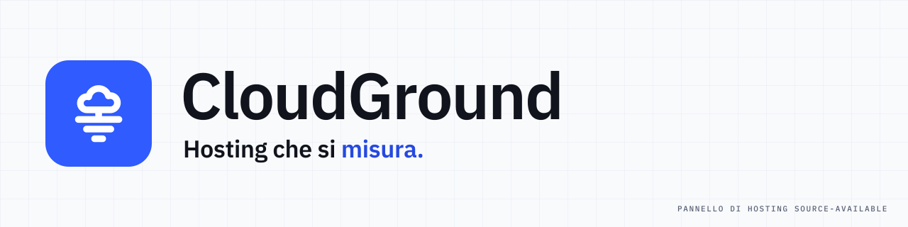
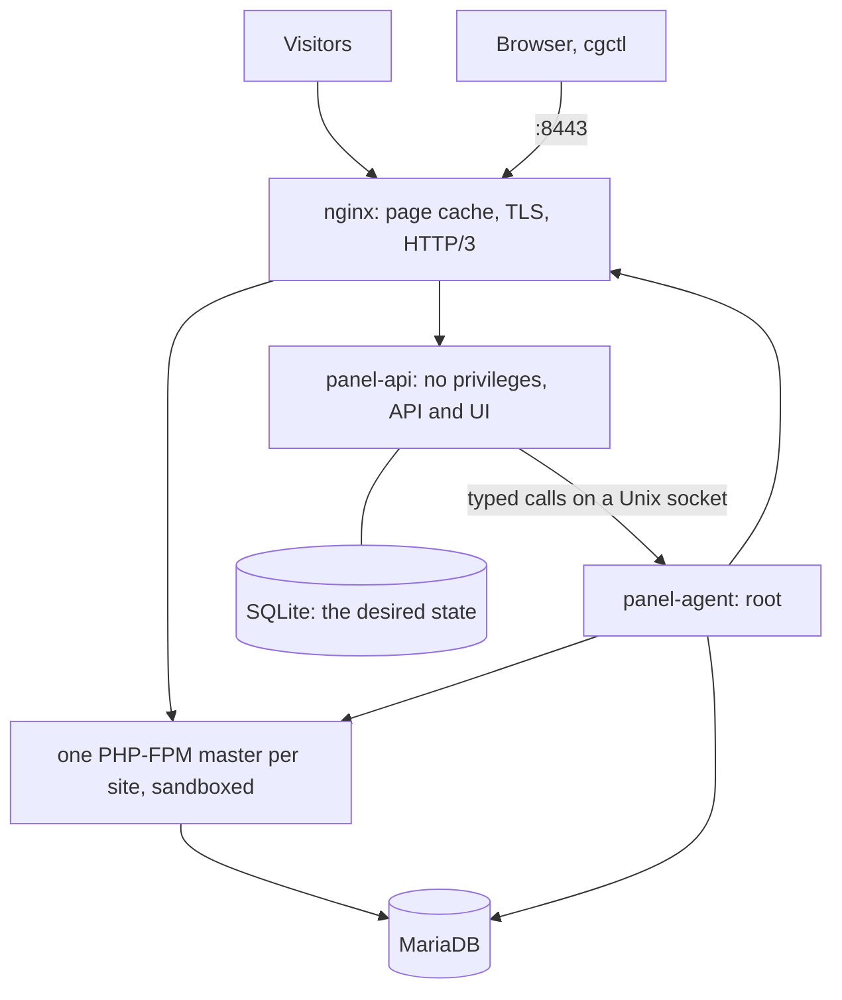

<p align="center">
  <picture>
    <source media="(prefers-color-scheme: dark)" srcset="docs/media/banner-dark.svg">
    <source media="(prefers-color-scheme: light)" srcset="docs/media/banner-light.svg">
    
  </picture>
</p>

# CloudGround

A self-hosted control panel for one Ubuntu server, built to make websites fast and changes safe.

Create a WordPress, WooCommerce, PHP, Laravel, Node.js, Python, static or reverse-proxy site and it starts out
cached, tuned for the machine, isolated from its neighbours and backed up off the server. Changes
go through a staging copy first, and a release that measures slower than production is not
promoted.

**[Try the demo](https://get.cloudground.it/demo/)**: the real panel with sample data, in your
browser (nothing you do there leaves it). Website and guide: [cloudground.it](https://cloudground.it).

> **Status: 1.0.** The API, `cgctl` and the MCP tools stay compatible through 1.x, and every
> release restores the backups of the ones before it. The code has had two internal security
> reviews and no external audit ([SECURITY.md](./SECURITY.md)): keep backups off the box.

## What it does

- **Sites in one step**: WordPress, WooCommerce, PHP, Laravel, static files and reverse proxies.
- **A page cache in nginx**, purged precisely by a WordPress connector, with one render per missing
  page, stale copies served while they refresh, and pages stored already compressed.
- **Sized from the hardware**: PHP-FPM workers, OPcache and the InnoDB buffer pool follow the
  server's memory and CPUs.
- **Staging and Safe Push**: copy production, work on the copy, then let Performance Guard compare
  the two; a regression in latency, queries or errors stops the promotion. Rollback is one command.
- **Backups that are restored for real**: restic, encrypted and deduplicated, to storage off the
  server, with scheduled test restores that prove a snapshot works.
- **Sites kept apart**: a Unix user, a PHP-FPM master, a systemd sandbox and a database account
  per site; SFTP jailed in the site's folder.
- **And the rest of the daily work**: Let's Encrypt, drift detection on every file the panel
  writes, per-site cron, a file manager, a database browser, one-click sign-in to wp-admin, an HTTP
  API with tokens, and an interface in five languages.

## Requirements

| | |
| --- | --- |
| System | Ubuntu 24.04 LTS or 26.04 LTS |
| Architecture | amd64 |
| Memory | 1 GB at least, 2 GB recommended |
| Disk | 10 GB free |
| Ports | 80 and 443 free: CloudGround serves them |

CloudGround configures nginx, PHP-FPM, MariaDB and systemd itself, so it wants a server of its own.

## Install

From a release, as root:

```sh
curl -fsSL https://get.cloudground.it | sudo bash
```

From a build of this repository (Go 1.26 and Node 22 on your machine, or Docker):

```sh
make dist    # or: make docker-dist
scp -r dist installer root@your-server:/root/cloudground/
ssh root@your-server 'CLOUDGROUND_LOCAL_BUILD=/root/cloudground/dist bash /root/cloudground/installer/install.sh'
```

The installer checks the machine, installs nginx, PHP-FPM, MariaDB, restic, certbot and wp-cli,
creates the users and secrets, starts the services and prints a one-time setup address.

The panel answers on its own port, **https://server-address:8443**, with a self-signed certificate
at first; ports 80 and 443 belong to the sites. **Settings → Panel domain and HTTPS** gives the
panel a domain with a Let's Encrypt certificate that renews itself.

The full guide is at [cloudground.it/docs](https://cloudground.it/en/docs).

## How it is built



`panel-api` holds no privileges and never runs a shell. Every privileged action is a typed call
(create a site, deploy a release, restore a snapshot) to `panel-agent`, which starts programs from
argument lists only. More in [docs/architecture.md](./docs/architecture.md).

## Documentation

How to use the panel (install, sites, cache, staging, backups, the command line) is at
[cloudground.it/docs](https://cloudground.it/en/docs), from the `cloudground-it/cloudground-docs`
repository. This repository keeps the documents for developers:

| | |
| --- | --- |
| [Developer documentation](./docs/README.md) | where to start |
| [How CloudGround fits together](./docs/architecture.md) | the processes and how a change reaches the server |
| [Security model](./docs/security-model.md) | trust boundaries and isolation |
| [HTTP API](./docs/api.md) | every route, generated from the code |
| [Benchmarks](./bench/README.md) | the method and the tools |

## Development

```sh
make build    # the UI and the binaries into bin/
make test     # go vet and go test ./...
make dist     # linux/amd64 binaries into dist/
```

The end-to-end suite runs on a real, disposable server:

```sh
make docker-e2e-bin && scp dist/cg-e2e root@<server>:/root/ && ssh root@<server> ./cg-e2e -test.v
```

[CONTRIBUTING.md](./CONTRIBUTING.md) explains the rest. The rule that matters most: **check it
on the server, do not trust the diff.**

## Licence

CloudGround is source-available under the [Elastic License 2.0](./LICENSE): you may use, modify
and self-host it, including to host sites you build for your clients; you may not offer CloudGround
to others as a hosted or managed service.

In plain words:

- **Allowed:** running it on your own servers, for your own sites and for the client sites you
  build and host, as long as the clients do not get access to the panel.
- **Not allowed:** selling hosting where customers get the CloudGround panel or its features, that
  is, CloudGround as a service.
- **Anything else:** ask the maintainer before you rely on it.

The WordPress connector under `connector/` (the mu-plugin and the object-cache drop-in, which run
inside WordPress) is GPL-2.0-or-later: see [connector/LICENSE](./connector/LICENSE).

A site's country rules use the [IP to Country Lite](https://db-ip.com/db/download/ip-to-country-lite)
database, which the server downloads from DB-IP: IP Geolocation by [DB-IP](https://db-ip.com),
licensed under [CC BY 4.0](https://creativecommons.org/licenses/by/4.0/). It is not part of this
repository or its releases.
