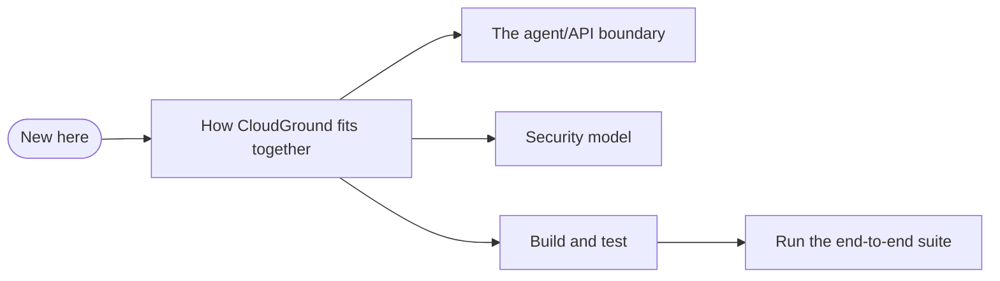

# Developer documentation

These pages are for whoever changes CloudGround's code. Using the panel (installing it, running
sites, backups, the command line) is covered in the user documentation at
<https://docs.cloudground.it>, which has its own repository, `cloudground-it/cloudground-docs`.

Every page has one job. A **how-to** walks through a task, a **reference** lists exact values,
an **explanation** gives the reasons behind a design. The explanations are worth reading once;
the how-tos are for when the task comes up.

## How-to

| Page | For when you need to |
| --- | --- |
| [Build and test](./build-and-test.md) | build the binaries and the UI, run what every commit must pass, regenerate the generated files |
| [Run the end-to-end suite](./e2e.md) | choose the e2e sections a change touches, show a new check fails on the old build, run the full gate |
| [Install, update and uninstall a server](./install-update-uninstall.md) | install (pinned and verified), move a server to a newer release and what is kept or rolled back, take CloudGround away with or without its sites |

## Reference

| Page | What it holds |
| --- | --- |
| [CloudGround HTTP API](./api.md) | every route with its access rule and purpose, generated from `internal/api/routes.go` (never edit it) |
| [The SPEC.md convention](./spec-convention.md) | where a package's specification sits, what goes in it, how code and commits refer to it |
| [Benchmarks](../bench/README.md) | how performance is measured and with which tools (`cmd/cgbench`); results are published once measured on a release |

## Explanation

| Page | The question it answers |
| --- | --- |
| [How CloudGround fits together](./architecture.md) | which processes there are, where state lives, how the job queue carries a change to the server |
| [The agent/API boundary](./agent-api-boundary.md) | why the API holds no privileges, and how every call to the root agent is checked |
| [Security model](./security-model.md) | the trust boundaries, how sites are kept apart, how secrets are stored, what the internal review found |

## Rules for these pages

- The code and the package `SPEC.md` files are the source of truth. A page that disagrees with
  them is wrong, and is fixed in the same change.
- Active voice and short sentences. Other control panels and hosting companies are not named.
- Diagrams are Mermaid blocks, which GitHub renders.

New to the code? Begin with [How CloudGround fits together](./architecture.md).
