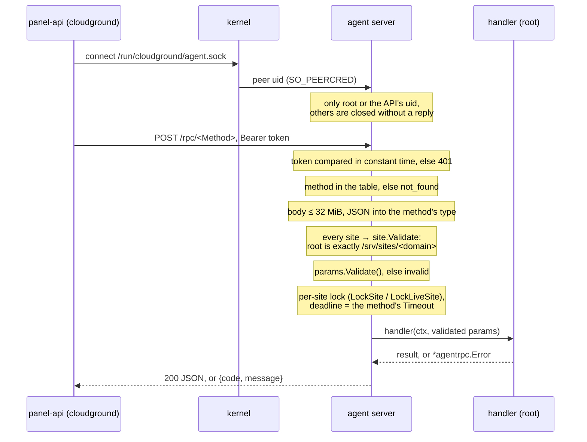

# The agent/API boundary

*Explanation.* Why the panel is two processes, what crosses the socket between them, and the
checks every call passes before root does anything.

## Two processes, one privileged

`panel-api` is the large surface: HTTP parsing, JSON, sessions, the whole API, the UI. It runs as
the unprivileged user `cloudground`, holds no capabilities and never runs a command. `panel-agent`
runs as root and is the only process that changes the system. A bug in the API, where bugs are most
likely, cannot become root: the API has no root to give away. It can only ask the agent for one of
the methods of a fixed table, and the agent checks each request on its own.

## The transport

The protocol is `internal/agentrpc` (its SPEC.md is the contract):

- HTTP/1.1 over the Unix socket `/run/cloudground/agent.sock`, mode `0660`, group `cloudground`;
- one call is `POST /rpc/<Method>` with the parameters as JSON; the answer is the result, or an
  error with a `code` and a user-safe `message`;
- the parameter and result types are in `internal/rpc`, one Go type per JSON document, pinned by
  golden files in `internal/rpc/testdata/wire`.

## What every call passes

The order matters. A caller that is not the API or root learns nothing. A handler never validates a
site itself: the server replaces each site in the parameters with its validated value, so a handler
cannot forget. A mutating call, once sent, is detached from the caller's cancellation, so a closed
browser tab never leaves the API unaware of a change the agent made.

## Errors that are safe to show

An agent error's `message` contains no command line, no host path, no tool output and no secret.
The full chain goes to `detail`, which only the journals see. A handler marks a message as safe by
returning an `*agentrpc.Error` (`Invalid`, `NotFound`, `Conflict`, `Wrap`); anything else becomes
`internal` with the method's fixed `Fail` text. The API maps the code to a status in one helper,
`respondAgentErr`.

## argv, never a shell string

The agent starts every tool through `internal/agent/host` with an argv array. No domain, path or
name ever passes through a shell, so none can become command injection. Names are validated before
they reach a tool; one that starts with `-` is refused before any process starts. Secrets never go
in argv, which any user can read in `/proc/<pid>/cmdline`: they travel on stdin, in a `0600`
root-owned file, or in a root process's environment. Errors are classified from exit codes and
other structured signals, never from the text of stderr (internal/agent/host/SPEC.md).

This boundary is not negotiable in a change.

## Site trees: sitefs

A site's tree belongs to its tenant, who can rename or symlink any entry at any moment, even while
root works in it. So no root-side code opens a path in a site tree directly, and none shells out to
`chown`, `chmod` or `cp` there. Every such operation goes through `internal/agent/sitefs`, where each
lookup is `openat2` with `RESOLVE_BENEATH | RESOLVE_NO_MAGICLINKS` on the site's root: the kernel
refuses, at the moment of each open, any path that would leave the root. Without `openat2` the
package fails closed. Use `Root.Chown`, `Chmod`, `ChownTree` and `CopyTree`; site layout links are
relative so they resolve beneath the root.

This matters more on Ubuntu 26.04, whose coreutils follow a symlink given to `chown -h` or
`chown -R` (see AGENTS.md): there, a root `chown` on a path the tenant can turn into a link is a
root escalation.

## Adding a method

1. Specify it in the domain's `SPEC.md` (`internal/agent/ops/<domain>`): parameters, result, lock,
   timeout, errors.
2. Add its types to `internal/rpc` with a golden file (`CG_WIRE_UPDATE=1` writes it).
3. Add a row to the method table (`internal/agentrpc/methods.go`): `Sites` if the parameters carry
   sites, the lock, the timeout, `ReadOnly` only if it changes nothing, the `Fail` text.
4. Register the handler in `internal/agent`; the agent refuses to start with a handler that has no
   table row, and a test fails for a row without a handler.

## Where to go next

[Security model](./security-model.md) covers the other boundaries: browser to panel, site to site,
WordPress to panel.
