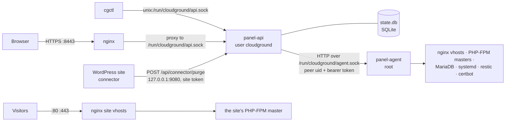
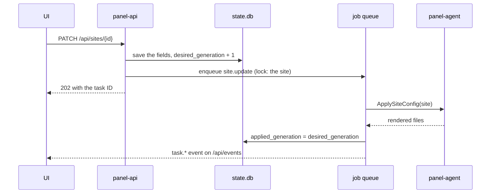

# How CloudGround fits together

*Explanation.* How the parts of CloudGround fit together, and where a change travels from a click
to the server.

## The parts

| Part | Source | Runs as | Job |
| --- | --- | --- | --- |
| `panel-api` | `cmd/panel-api`, `internal/api` | user `cloudground` | the HTTP API and the embedded UI, the state database, the job queue and its scheduler |
| `panel-agent` | `cmd/panel-agent`, `internal/agent` | root | every privileged action: users, files, nginx, PHP-FPM, MariaDB, certificates, backups |
| `cgctl` | `cmd/cgctl` | whoever runs it | a client of the API for scripts, authenticated with an API token |
| UI | `ui/` | the browser | a Nuxt 4 single-page app; its build in `ui/dist` is embedded into `panel-api` |
| connector | `connector/` | inside each WordPress site | a mu-plugin and an APCu object-cache drop-in; they purge the page cache through the API |

The panel answers on its own port, 8443. Ports 80 and 443 belong to the sites. nginx proxies the
panel to `panel-api`, which listens on the Unix socket `/run/cloudground/api.sock`, handed over by
`cloudground-api.socket`. A second, plaintext listener on loopback (`CLOUDGROUND_LOCAL_LISTEN`,
default `127.0.0.1:9080`) serves only the connector's purge route and `/healthz`
(internal/api/SPEC.md §1.8).

## Desired state, then apply

The state database (`/var/lib/cloudground/state.db`) is the single source of truth: what every
site and the panel itself should look like (internal/state/SPEC.md). The agent renders the system
from it. Nothing in the store is read back from the system, except a few observations such as a
certificate's expiry.

A site carries two counters. A change to its settings raises `desired_generation`; the apply job
renders the site and records `applied_generation` and any `last_apply_error`. A site whose two
counters differ has a change still to apply, and the UI shows it.

## Jobs

Every background operation is a job in the `jobs` table: provisioning, deploys, backups,
certificate renewals, the periodic maintenance (internal/jobs/SPEC.md). A job declares the lock
keys it needs, so two jobs on the same site never overlap, and a person's jobs run before the
scheduler's. It has a status (`queued`, `running`, `succeeded`, `failed`, `canceled`), progress and
a bounded log. On shutdown the queue drains; after a restart, an interrupted job either resumes
(when its kind is safe to run again) or fails with a clear reason. The UI calls jobs *tasks* and
follows them through `GET /api/tasks/{id}` and the event stream.

## Events

What a browser shows changes through events, not polling. Whatever changes something publishes one
typed event on an in-process bus; `GET /api/events` streams them as Server-Sent Events, filtered to
what each user may see (internal/api/events/SPEC.md).

## Serving a site

The agent writes, for each site, an nginx vhost rendered by `internal/engine/nginx` from the
page-cache policy of `internal/velocity`, and a PHP-FPM master of its own (`internal/phpfpm`): one
systemd unit, one pool, the site's user, the site's sandbox. A cached page never reaches PHP. The
tuning of nginx, PHP and MariaDB comes from `internal/tune`, sized on the machine. Every one of these
renders is pure and pinned by golden files.

## Configuration

One loader, `internal/config`, reads `/etc/cloudground/panel.env` (API and agent) or
`/etc/cloudground/cgctl.env` (CLI), then the environment, and validates every `CLOUDGROUND_*` key
at start (internal/config/SPEC.md).

## Where to go next

[The agent/API boundary](./agent-api-boundary.md) explains what crosses the agent socket and how it
is checked.
