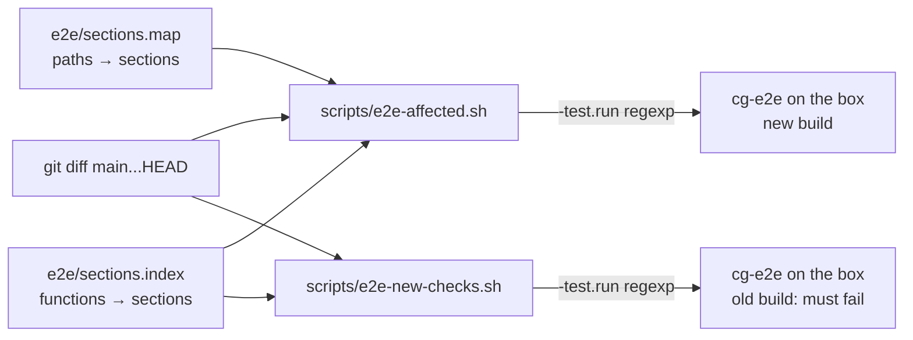

# Run the end-to-end suite

*How-to.* Prove a change on a real server: run the sections it affects, show that a new check fails
on the old build, add a section, and run the full gate at the end of a phase. The suite's own
reference is `e2e/README.md` (inputs, flags) and `e2e/SECTIONS.md` (sections, fixtures, lanes).

> [!CAUTION]
> The suite runs as root on a CloudGround server and changes it: it creates and deletes sites,
> restarts the API, plants files in site trees. Run it only on a throwaway server (AGENTS.md, hard
> rules 1 and 2).

## The shape of the suite

`TestE2E` (build tag `e2e`) is a list of **sections**, the `sections` table in `e2e/e2e_test.go`.
Each section is a subtest, `TestE2E/<name>` with spaces as underscores, and gives the same verdicts
alone as in a full run. What a section needs from outside itself is a **fixture** it declares (the
WooCommerce site, the feature site, the feature site's staging copy); the first section that asks
makes it, the later ones reuse it.



## Build and copy the binary

```sh
make docker-e2e-bin                       # or make e2e-bin with Go: dist/cg-e2e, linux/amd64
scp dist/cg-e2e root@<server>:/root/
```

On the box, the admin credentials come from `/root/cloudground-admin.env` (or `PANEL_EMAIL` and
`PANEL_PW`); the public address is taken from the default route, or from `IP` when you set it.

Start every remote run with `ssh -n` and an outer `timeout`, so a hung session cannot block you,
and watch progress on the box rather than waiting on a silent background task. Group several
changes into one cycle when you can: there is one test server.

## 1. Per change: the affected sections, on the new build

```sh
R=$(scripts/e2e-affected.sh main) &&
  timeout 3h ssh -n root@<server> ./cg-e2e -test.v -test.run "$(printf %q "$R")"
```

`e2e-affected.sh` maps each changed path outside `e2e/` through `e2e/sections.map` (the first
matching line wins; a path no line matches selects every section), and each changed line of
`e2e/*.go` through `e2e/sections.index` to the sections that reach its function. When nothing is
affected (documentation, unit tests, `bench/`) it prints nothing and exits 1, so an empty
`-test.run`, which would run everything, cannot slip through. `printf %q` quotes the regexp for the
remote shell.

## 2. Per new check: the new checks, on the old build

Every new check must fail on the build that has the bug, and pass on the fix. Install the old
binaries on the box, then:

```sh
R=$(scripts/e2e-new-checks.sh main) &&
  timeout 3h ssh -n root@<server> ./cg-e2e -test.v -test.run "$(printf %q "$R")"
```

The script finds the `h.check`, `h.assert` and `h.fail` calls the diff adds or changes, and the
helper calls that name a check after a string. Their sections run whole, but only those checks are
reported: `RESULT` should show them failed. A check whose call did not change but whose inputs did
is not found; use workflow 1 for it.

Then make sure the check asserts on the product's behaviour, not on the test's own setup.

## 3. At the end of a phase: the full suite

```sh
timeout 4h ssh -n root@<server> ./cg-e2e -test.v
```

Sequential, in the table's order: this is the gate before a phase is pushed. `CG_E2E_PARALLEL=1`
runs independent lanes side by side and is faster, but it adds load and interleaves the sections:
use it for a quick look, not for the gate.

## Add a section

1. Write the section as a `harness` method in an `e2e/*_test.go` file with the `e2e` build tag.
2. Add a row to `sections` in `e2e/e2e_test.go`: the name (no `, = | / @ #`), the method, the
   fixtures it uses, and a lane only if it shares nothing every section shares.
3. Add its row to the table in `e2e/SECTIONS.md`, with the same fixtures.
4. Map the paths it exercises in `e2e/sections.map`, above any general line that would also match.
5. Regenerate the index: `make docker-e2e-index`.
6. Run `make docker-test`. The unit tests in `e2e/sections_test.go` (`TestSectionsDeclared`,
   `TestSectionsDocumented`, `TestSectionsMap`, `TestSectionsIndex`) fail until all four places
   agree.

## The upgrade section

`R-6.5 upgrade` checks an update from one release to the next on the box: it needs releases, so it
runs only when `CG_E2E_UPGRADE_BUNDLE` names them, and otherwise logs that it was skipped. The
bundle is four releases of the current tree, built and signed with a throwaway key whose binaries
take updates from `http://127.0.0.1:18931`, where the section serves them itself (v0.3.0's API exits
at once, for the rollback; `scripts/upgrade-bundle.sh`):

```sh
make docker-upgrade-bundle docker-e2e-bin
scp dist/upgrade/upgrade-bundle.tar.gz dist/cg-e2e root@<public-ip>:/root/
ssh -n root@<public-ip> 'tar -C /root -xzf upgrade-bundle.tar.gz &&
  CG_E2E_UPGRADE_BUNDLE=/root/upgrade-bundle timeout 30m ./cg-e2e -test.v -test.run "^TestE2E$/^R-6.5_upgrade$"'
```

It replaces the installed binaries (v0.1.0 over the box's build, then v0.2.0, v0.2.1, and the
rolled-back v0.3.0) and puts the box's own build back at the end with `cgctl install --from`, as
well as `highest-release` and the snapshot directory. Run it alone, or last: it is the last section
of a full run. A box on which it was interrupted is put back by installing your build again
(`CLOUDGROUND_LOCAL_BUILD=…`) after removing `/var/lib/cloudground-agent/highest-release`, which then
names a test release.

`cgctl uninstall` is not run on the box (it would take the suite's server apart): its check is the
container run of `make docker-install-test`, install, uninstall and install again
(internal/install/SPEC.md §8).

## Read the result

The log ends with one line per section that ran (time, passed and failed checks), then
`RESULT: <pass> passed, <fail> failed` and the failed checks. The exit status is non-zero if any
check fails. A fixture that could not be made fails its sections outside any check and counts as
`fixture: <name>`, so a check filter never hides it.

## Next step

[The SPEC.md convention](./spec-convention.md): what to write before the code that a new check
proves.
