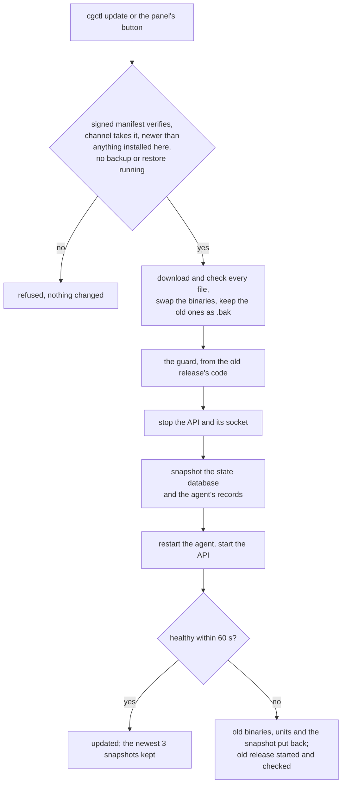

# Install, update and uninstall a server

How a CloudGround server is installed, moved from one release to the next, and taken away again,
with the commands an operator runs and what each keeps. The contracts are
`internal/install/SPEC.md` (§5–6 the install, §9 the uninstall, §10–11 updates and compatibility)
and `internal/agent/ops/panel/SPEC.md` §2 (the self-update and its guard). Every command below runs
as root on the server.

## Install

The installer is a short bash bootstrap that downloads one release from GitHub Releases, checks
it, and hands over to `cgctl install`.

```sh
# the newest stable release (the documented command until get.cloudground.it exists)
curl -fsSL https://github.com/cloudground-it/cloudground/releases/latest/download/install.sh | sudo bash

# the same, once the short address is live
curl -fsSL https://get.cloudground.it | sudo bash

# one release, pinned
curl -fsSL https://github.com/cloudground-it/cloudground/releases/download/vX.Y.Z/install.sh | sudo bash
```

Each copy of `install.sh` names its own release and the SHA-256 of that release's `cgctl`, which it
checks before running it; `cgctl` then refuses any file whose signed manifest does not verify with
the release key compiled into it. `get.cloudground.it` and `releases/latest` serve the newest stable
release's copy; a beta is never served there.

### Verify the script before running it

The script host (GitHub Pages behind `get.cloudground.it`, or the release assets) could be made to
serve a different script, and a script decides what runs. To run only the genuine one, download it,
check it against the release's signed manifest with the release key published in the documentation
(it is also `releaseKeys` in `internal/version/keys.go`), and run it:

```sh
v=vX.Y.Z
key='<the release key, base64, from the documentation>'
base=https://github.com/cloudground-it/cloudground/releases/download/$v
curl -fsSLO "$base/install.sh" -O "$base/SHA256SUMS" -O "$base/SHA256SUMS.sig"

# the ed25519 public key as PEM (a 12-byte DER header, then the 32-byte key)
{ printf '\x30\x2a\x30\x05\x06\x03\x2b\x65\x70\x03\x21\x00'; printf %s "$key" | base64 -d; } > release.der
openssl pkey -pubin -inform DER -in release.der -out release.pem
base64 -d SHA256SUMS.sig > SHA256SUMS.bin
openssl pkeyutl -verify -pubin -inkey release.pem -rawin -in SHA256SUMS -sigfile SHA256SUMS.bin  # Signature Verified Successfully
grep -qx "version $v" SHA256SUMS && grep '  install.sh$' SHA256SUMS | sha256sum -c -               # install.sh: OK

sudo bash install.sh
```

`gh attestation verify install.sh --repo cloudground-it/cloudground` checks, independently, that
the file was built by the release workflow. The reasons and the remaining risks are in
`internal/install/SPEC.md` §6.1.

### Options

`cgctl install --help` lists them. The ones the bootstrap passes through: `--skip-packages` (no
apt, no downloads), `--container` (no systemd, kernel or firewall work). The environment:
`CLOUDGROUND_VERSION=latest` (an unstamped copy hops to the latest release's own script),
`CLOUDGROUND_CGCTL_SHA256`, `CLOUDGROUND_INSTALL_SHA256` and `CLOUDGROUND_RELEASE_PUBKEY` (anchors
taken out of band), `CLOUDGROUND_LOCAL_BUILD=<dir>` (a local build, for development).

Running the installer of the **installed** release again re-converges the server (a repair): each
step changes only what differs. `cgctl doctor` reports what differs without changing it. The
installer of **another** release refuses to run over an installed panel and points to `cgctl
update`: it has no snapshot and no rollback.

## Update

There is one update, done by the agent, which two places can start:

- the panel: Settings → Panel updates, the update button (`POST /api/panel/update`);
- the shell: `cgctl update`.

```sh
cgctl update --check            # what would be installed; changes nothing
cgctl update                    # the newest release of the panel's channel
cgctl update --to vX.Y.Z        # a given release (never an older one)
cgctl update --channel beta     # the newest release of another channel, this once
```

What happens, in order:



- **Kept**: everything but the binaries and, when the release changes them, the unit files. The
  state database is migrated forward by the new API at its first start; an update from v0.1.0 to
  v0.3.0 runs every schema step in between, since they travel in the binary. **Site data is never
  touched**: the sites' files, their databases, certificates and backups are outside what an update
  reads or writes, and the sites keep serving throughout (nginx and the sites' PHP are not
  restarted). The panel itself answers 502 for the few seconds of the restart.
- **Refused**: a release not signed by a key the installed release carries; a beta on the stable
  channel; any release not newer than the running one or than the newest ever installed here
  (`/var/lib/cloudground-agent/highest-release`); an update while a backup, a restore or a job that
  cannot resume is running.
- **Backups**: a backup taken by any 0.x or 1.x release restores on every 1.x release, in every
  mode (everything, files, database, one file or folder) and as a download, and passes its restore
  test there. The e2e section `R-6.6 restore across updates` checks it on real old releases.
- **Rolled back**: a release that is not healthy within 60 s (both services running the new
  binaries, and the API's `/healthz` answering, which pings the agent) is replaced by the previous
  one, with the state as it was before the update. `cgctl update` exits 1 and says so; the guard's
  journal is `journalctl -u cloudground-update-guard`, its verdict
  `/var/lib/cloudground-agent/update-result.json`.
- **Snapshots**: `/var/lib/cloudground-agent/update-snapshots/<time>-<from>-to-<to>/`, the newest
  three. Each holds the state database (with its WAL) and the agent's site and database records, and
  `snapshot.json` naming where each file goes back, with its owner, mode and SHA-256.

A newer release's `install.sh` does not update an installed server: it refuses and names `cgctl
update --to <release>`. What a patch and a minor release may
change, and why an agent and an API of different releases never talk during the restart, is
`internal/install/SPEC.md` §11.

## Uninstall

```sh
cgctl uninstall --plan                      # every action, nothing changed
cgctl uninstall                             # asks [y/N]; --yes does not ask
cgctl uninstall --remove-sites              # also deletes the sites; asks for the hostname
cgctl uninstall --remove-sites --purge-packages
```

| | default | `--remove-sites` |
| --- | --- | --- |
| CloudGround's services, units, drop-ins, binaries, its nginx, sshd, sysctl, logrotate, cron and certbot hook files, the panel user, its state | removed | removed |
| nginx.conf, the distribution's default site | put back as they were | put back |
| nginx itself (the package) | stays installed, **stopped and disabled** (`systemctl enable --now nginx` starts it) | same |
| the sites' files under `/srv/sites` | **kept** (nothing serves them) | deleted |
| the site users `cg-site-<id>` | **kept, locked** (they own the files) | deleted, with their groups |
| the sites' databases and database accounts, MariaDB and its tuning file | **kept** | the CloudGround ones dropped; tuning removed |
| the sites' certificates (`/etc/letsencrypt/live/<domain>`) | kept | deleted |
| certificates brought for a site | moved to `/root/cloudground-uninstall/custom-certs` | deleted |
| backups, in their repository | **never touched** | **never touched** |

Before anything is removed, the uninstall copies the panel's state database and its key to
`/root/cloudground-uninstall/state/` and writes `/root/cloudground-uninstall/backup.env` with the
backup repository and its password (root only): the repository is kept, and without its password
no backup can be read. `README.txt` there lists every repository the panel used. `backup.env` is
plain text: store it somewhere safe, off the server, then delete it (the uninstall says so).

The sites' certificates are kept, but their renewal used CloudGround's ACME webroot, which is gone:
they stop renewing. The uninstall lists them and how to renew one with another web server (`certbot
certonly --webroot -w <root> --cert-name <domain> -d <domain>`) or remove it (`certbot delete
--cert-name <domain>`).

```sh
cd /root/cloudground-uninstall && set -a && . ./backup.env && set +a && restic snapshots
```

`--purge-packages` removes, last, the packages the installer recorded installing
(`/var/lib/cloudground-agent/installed.json`), of the data plane only: nginx, certbot, PHP, and
MariaDB only with `--remove-sites` and no other database left. A package that was on the server
before the install is never recorded, so never removed; neither are `curl`, `git`, `cron` and the
like. A server installed before the record existed purges nothing.

The uninstall refuses while a backup, a restore or a job that cannot resume is running. Every action
can run again: a run that stopped half way is finished by running `cgctl uninstall` again, and on a
server with nothing left it says there is nothing to remove.

## Next step

[Build and test](./build-and-test.md): `make docker-install-test` runs install, uninstall and
install again in Ubuntu containers; [Run the end-to-end suite](./e2e.md) has the release-to-release
update on a real server (`R-6.5 upgrade`).
