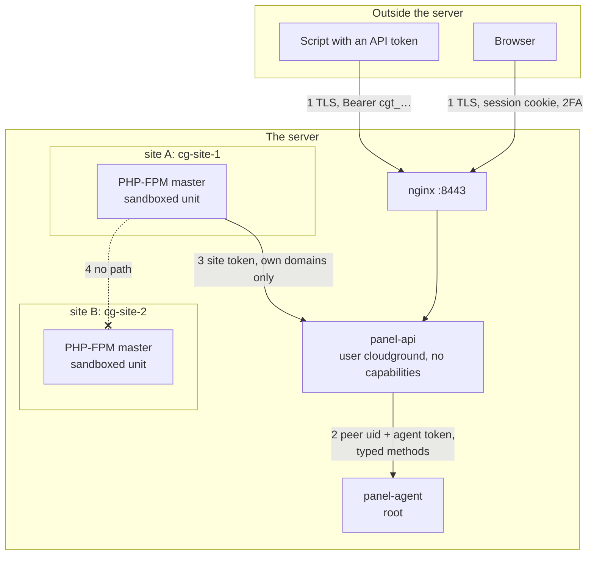

# Security model

*Explanation.* The trust boundaries of CloudGround, how each one is enforced, and what the
internal review found. The exact rules live in the SPEC.md files cited here; this page is the map.

## Boundaries

| # | Boundary | Enforced by |
| --- | --- | --- |
| 1 | browser or script → panel | TLS; argon2id passwords; opaque session tokens in the database, so they can be revoked; cookies `HttpOnly`, `SameSite=Strict`; per-network and per-account sign-in limits that delay and never lock (a delay grows to a minute for the network that fails, and adds at most 2 s for the owner signing in from elsewhere); optional TOTP with replay refused; an optional rule that admins must enrol in 2FA; API tokens only for enabled admins, for automating sites: never for account, user, token, site-shell or routing routes, nor for the panel's governance (the 2FA requirement, backup destination and keys, alert webhook, DNS credential, release channel, firewall, panel certificate, self-update, accepting drift) (internal/api/SPEC.md §1.2, §1.2.1, §2) |
| 2 | API → agent | peer uid from the kernel, a shared token in constant time, a fixed method table, central site validation ([the agent/API boundary](./agent-api-boundary.md)) |
| 3 | WordPress → panel | a per-site connector token, looked up by its hash; a purge keeps only URLs on that site's domain and aliases (internal/api/SPEC.md §8) |
| 4 | site → site, site → system | a Unix user, a PHP-FPM master and a systemd sandbox per site, a database account per site (below) |

## Keeping sites apart

Each site has its own Unix user `cg-site-<id>`, its own systemd slice and its own PHP-FPM master
(internal/phpfpm/SPEC.md). One master per site keeps OPcache and APCu, which live in the master's
shared memory, out of other sites' reach. The tenant boundary is the unit's mount namespace, not
`open_basedir`, which cost 28 % of uncached throughput on the test box.

The sandbox (`phpfpm.Sandbox`, pinned in `internal/phpfpm/testdata/sandbox.golden`) is one list of
unit properties shared by the PHP master, the site shell and wp-cli and cron runs:

- the whole of `/srv/sites` and `/var/log/cloudground` is an empty read-only mount, with only the
  site's own tree and log folder bound back, read-write;
- the panel's own folders, nginx, certificates, MariaDB's configuration and backups are
  inaccessible; `/home` is hidden;
- private `/tmp` and `/dev`; other users' processes are invisible;
- `NoNewPrivileges`, an empty capability bounding set, no namespaces, the kernel's tunables,
  modules, logs and clock protected.

PHP itself runs with `disable_functions = exec,passthru,shell_exec,system,proc_open,popen`, and keeps
its temporary files, uploads and sessions in the site's own `tmp/`.

SFTP logins are chrooted to the site root, which is owned by root so the tenant cannot replace it.
The optional site shell is a second login, `cg-shell-<id>`, with the same uid; its session runs as a
transient unit inside the same sandbox (internal/agent/ops/sftp/SPEC.md). Only an administrator,
signed in with a session, can add a shell key.

A site's database account is granted on its one database. Quarry runs each statement as a
throwaway account granted on that database alone (read-only: `SELECT, SHOW VIEW`), so the database
server, not an inspection of the SQL, enforces the boundary (internal/agent/ops/db/SPEC.md §3).
A read-only panel account sees the tables and their structure only: the rows and the SQL editor
are for administrators and operators, as wp-config.php is in the file manager.

## Secrets at rest

Every credential the panel keeps (the backup repository password, the object-storage key, the DNS
token for wildcard certificates, the alert webhook, each site's database password, connector token
and staging password, each account's TOTP secret) lives in the `secrets` table, sealed with
AES-256-GCM and bound to its name. The key is a separate file, `/var/lib/cloudground/secret.key`,
mode 0600. Without it the panel refuses to start rather than make a new key that would orphan every
secret (internal/state/SPEC.md, invariant 1–2). Session and API tokens are stored as hashes.

The key sits on the same disk. This protects a copy of `state.db` on its own, not a machine
someone already controls.

## The network

The API listens on a Unix socket behind nginx and on a plaintext loopback port for the connector
only. When the firewall (ufw) is active, the installer opens 22, 80, 443 (TCP, and UDP for HTTP/3)
and 8443. It never turns ufw on: many servers sit behind a provider's firewall already, and a
script enabling ufw can lock the operator out (SSH on another port). When ufw is installed but off,
the end of the install says so and prints the `ufw allow` commands for sshd's real ports and the
panel's, then `ufw enable` (internal/install/SPEC.md §3, steps 24 and 31). The client address for
limits and the audit log comes from nginx's `X-Real-IP` only on the Unix socket, which only nginx
can open; on TCP, loopback included, the peer address counts and the header is ignored
(internal/api/SPEC.md §2.7).

## Findings of the internal review

Kept because a list of what was wrong says more about a codebase than a list of what is right.

| Severity | What was wrong | What changed |
| --- | --- | --- |
| High | The SQL console ran as the database superuser with the site's database only as the default schema. An operator of one site could read and write another tenant's tables by naming them in full. | Each statement runs as a throwaway account granted on exactly one database. The grants enforce the boundary. |
| Medium | Every sign-in was recorded as `127.0.0.1`, because the API sits behind nginx. The audit log could not say where a session came from, and every client shared one rate-limit bucket. | `X-Real-IP` is trusted on the Unix socket only, which only nginx reaches. |
| Medium | The file manager checked a path and opened it in a second call, as root, in a folder the tenant owns: a race could send a root read or write outside the site. The `chown` that followed also followed symlinks. | Every site-tree operation goes through `sitefs`: `openat2` beneath the site root, ownership changed through the descriptor. |
| Medium | The sign-in delay ("a delay, never a lock") was slept inside the account's queue of four attempts, panel and Quarry alike. Four wrong passwords a minute from one address, under the per-address limits, kept the queue full, so the real owner got `429` for as long as it went on. Quarry's default database user names (`site_<id>`) are easy to guess. | The delay is slept before the attempt queues, and the queue only holds the password check, bounded per network. Failures count per network (up to a minute of delay, spaced so that parallel guesses from one network or /48 are no faster than sequential ones) and per account from anywhere (at most 2 s), so the owner from another network gets in within a bounded delay. |
| Low | A TOTP code was accepted anywhere in its window with no record of use, so a captured code worked for about 90 seconds. | The last accepted time step is recorded per account and only moves forward. |

## Limits, stated plainly

- No external audit yet.
- A panel administrator is root on the machine, by design. The operator and read-only roles limit
  those accounts, not an admin.
- A local process can reach the API on loopback. It still needs credentials, and the sign-in limits
  apply.
- The sign-in limits never lock an account, so they cannot stop guessing from many networks at
  once. Each network (and IPv6 /48) is slowed by its own failures, to one guess a minute at an
  account however parallel, and the total grows with the number of networks, bounded by the
  password-check queue, not per account. Long, random passwords and 2FA
  are the defence against that. An attacker behind the owner's own address (a shared NAT, the same
  IPv6 /48) shares that network's delay with the owner.
- Drift detection covers the files the panel rendered. It is not a file-integrity monitor.
- The sandbox limits what a compromised site can reach. It does not make vulnerable application code
  safe. A way out of the sandbox is a vulnerability: report it as `SECURITY.md` says.

## Where to go next

[Build and test](./build-and-test.md) lists the checks every change passes.
