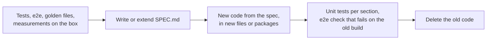

# The SPEC.md convention

*Reference.* Where a package's specification lives, what it holds, and how code, tests and commits
refer to it.

## One file per package, next to the code

A package with behaviour worth pinning has a `SPEC.md` in its folder. Today there are specs for
`cmd/cgctl`, `connector`, and in `internal/`: `agent/host`, `agent/sitefs`, every domain under
`agent/ops/` (`backup`, `certs`, `cron`, `db`, `dbstudio`, `files`, `migration`, `panel`,
`release`, `sftp`, `sites`, `staging`, `system`, `wp`), `agentrpc`, `api` and `api/events`,
`config`, `engine`, `guard`, `jobs`, `phpfpm`, `rpc`, `state`, `tune`, `velocity`, `version`.
List them with `find . -name SPEC.md`.

A spec is the contract for its package. When the spec and the code disagree, one of them has a bug,
and the change that fixes it updates both.

## What a spec contains

| Part | Content |
| --- | --- |
| Title and first paragraph | the package's job in one or two sentences, and who calls it |
| Sources | what the spec was derived from: tests, e2e sections, golden files, measurements on the test box, the callers |
| Numbered sections (`## 1.`, `### 1.2`) | the behaviour: inputs, outputs, every refusal with its exact message, limits, timeouts, defaults, invariants, what happens after a crash or a restart |
| Tables | anything with more than three cases: fields, error codes, statuses and their transitions, method rows |
| Tests | which tests check which section, and what only the box can verify |
| Not done here | what the package deliberately leaves to another one |

Write behaviour, not implementation: what a caller can observe. A value that was measured carries
its number and where it was measured, so nobody "optimises" it back without new numbers.

## How others cite it

- **Code** points at the section it implements: `// Exit codes (SPEC.md §4).`, or with the path when
  it is another package's spec: `// connector/SPEC.md §2.2–2.3`.
- **Tests** name the section they check, and the e2e sections name the spec sections they cover.
- **Commits** cite the plan item (`R-4.3`, `P9-2`) and, when the spec changes, say which sections
  changed and whether behaviour changed. A spec-only commit starts with `SPEC:`.

## The order of work: specification, then code

1. Write or extend the spec first, from what the system observably does.
2. Write the new code from the spec, in new files or a new package. Do not rewrite an old file line
   by line.
3. Test each section; a behaviour change or a bug fix also gets an e2e check that fails on the old
   build.
4. Delete the old code.

Keep behaviour identical unless the change says otherwise. When behaviour changes, the commit says
so.

## Next step

[Architecture](./architecture.md) shows how the packages these specs describe fit together.
